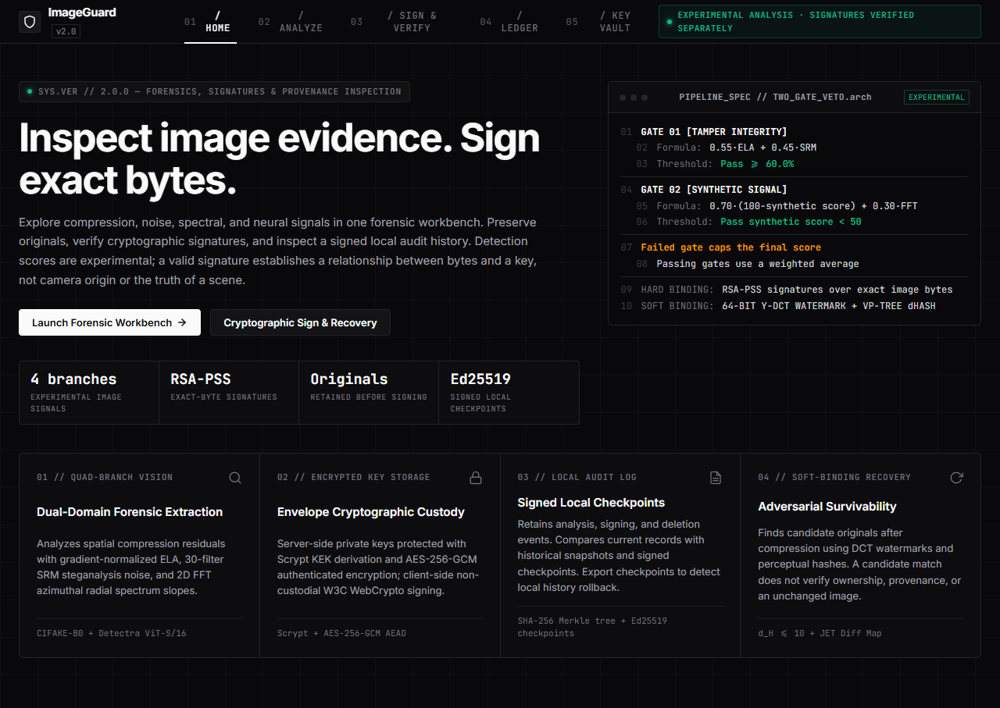

# ImageGuard — image forensics and signature workbench

ImageGuard is a **single-operator experimental workbench** for inspecting image manipulation signals, signing exact image bytes, comparing derivatives, and auditing recorded changes. It combines a FastAPI API, a browser interface, ONNX inference, classical image analysis, and cryptographic verification.

**Detection is an estimate. A valid signature proves a relationship between bytes and a key; it does not prove camera origin, ownership, or the truth of a scene.**



## What you can demonstrate

- Inspect ELA, noise residuals, spectral measurements, and neural or heuristic synthetic-media signals with visual overlays.
- Sign a derivative on the server while preserving the original upload, or create a detached signature in the browser without changing image bytes.
- Verify RSA-PSS signatures independently of detector results.
- Compare recompressed or edited images with candidate originals using watermarks and perceptual hashes. Candidate matches are not authenticated provenance.
- Detect changes to recorded evidence by comparing it with retained audit snapshots and an Ed25519-signed local Merkle checkpoint.
- Export an analysis PDF that distinguishes experimental scores, signature verification, metadata, and timestamp status.

## Quick start

Use Python 3.11. Commands below work in a terminal; on Windows, use `py -3.11` instead of `python` to create the environment.

```sh
python -m venv .venv
# Windows PowerShell:
.\.venv\Scripts\Activate.ps1
# macOS/Linux: source .venv/bin/activate
python -m pip install -r requirements.txt
python scripts/download_models.py
python -m uvicorn app:app --host 127.0.0.1 --port 8000 --workers 1
```

Open http://localhost:8000. Without configured operator credentials, access is restricted to loopback clients and allowed Host headers. Use one application worker: mutation admission and signing/audit serialization are process-local.

Model downloads are explicit. `model-manifest.json` records upstream repositories, immutable revisions, filenames, and SHA-256 checksums. Missing or mismatched weights activate the visible heuristic fallback; they never silently count as neural inference. Both models are external pretrained artifacts, not models trained by this project. Review their upstream licenses/model cards before redistribution.

## Safe demo data

```sh
python scripts/seed_demo.py
```

The seeder defaults to a separate `demo-data` directory, refuses to overwrite existing records, and labels its generated samples as procedural fixtures. To view it in PowerShell:

```powershell
$env:IMAGEGUARD_DATA_DIR = "$PWD\demo-data"
python -m uvicorn app:app --host 127.0.0.1 --port 8000 --workers 1
```

The demo server-key passphrase is `demo-passphrase-2026`. It is for demo fixtures only.

Suggested walkthrough: analyze a fixture, inspect the evidence and backend status, sign it, verify its signature, simulate recompression, and compare the resulting candidate match with the failed exact-byte signature. Show the limitations alongside the successful path.

## Trust boundaries

| Output | Meaning | Does not establish |
|---|---|---|
| Forensic analysis score | Experimental fusion of image signals | Calibrated probability, actual generator, or camera origin |
| Valid RSA-PSS signature | Current bytes verify under the registered public key | Legal ownership or signer identity beyond the operator's registration |
| Candidate watermark/dHash match | An identifier or visual similarity matched a record | Authenticity or provenance of the derivative |
| Unverified analysis metadata | ImageGuard's recorded analysis note | A signed, trusted C2PA credential |
| Received timestamp token | A remote service returned a token; trust is unverified | A validated trusted timestamp |
| Local receipt | Application clock and signature digest | RFC 3161 compliance or independent time attestation |
| Verified local checkpoint | Current record matches retained history and a locally trusted signed root | Protection from a host attacker holding both the database and signing secrets, or rollback without an externally retained checkpoint |

The API retains legacy field names such as `authenticity_score`, `ai_generation_prob`, and verdict strings for compatibility. These scores are **uncalibrated**. Editable EXIF is advisory input, not trusted provenance. A lightness-based reliability mask is inspired by prior work; this project does not run the full TruFor model. Local residual magnitude is not camera-specific PRNU fingerprint attribution.

Genuine C2PA credential issuance and certificate-chain trust validation are not implemented. Optional native parsing is labelled unverified. PNG analysis notes use `IMAGEGUARD_ANALYSIS`; other formats retain the note in the database. Detector predictions are never written as authoritative `digitalSourceType` assertions.

## Security and storage

- Every HTTP route, generated file, verification page, and WebSocket shares the operator access boundary.
- Remote hosting requires `IMAGEGUARD_ADMIN_PASSWORD` (at least 12 characters), `IMAGEGUARD_ADMIN_USER`, and an explicit `IMAGEGUARD_ALLOWED_HOSTS` list. Terminate HTTPS at a reverse proxy. This is not a multi-user authorization system or a public upload service.
- Cross-origin browser requests are rejected. Strings from filenames, names, errors, and metadata are escaped at HTML boundaries. The UI currently uses inline event handlers; CSP still permits inline scripts. XSS remains a security boundary even with non-exportable keys.
- New server keys require a passphrase of at least 12 characters. Private keys are encrypted with Scrypt and AES-GCM; the API does not export plaintext private keys.
- Browser private keys are non-exportable CryptoKeys in IndexedDB. Existing localStorage JWKs are migrated and removed only after successful persistence. Clearing browser storage loses those keys. A compromised browser origin can still request signing operations.
- A random installation pepper is generated under `instance/master-pepper` unless `MASTER_PEPPER` is configured. Protect and back up it alongside the database. The local checkpoint key is encrypted with this secret.
- The decoded-image limit is 20 million pixels; uploads are limited to 16 MiB, single-frame images of at least 64 × 64 pixels, with matching actual format and extension. The whole multipart body has a bounded allowance for fields.
- Expensive forensic inference runs off the event loop. Concurrent mutations return HTTP 429 instead of creating an unbounded queue.
- Original bytes are retained under `instance/originals`; server signing creates a new derivative. Deleting a record removes its files and appends a deletion event. The audit log retains record metadata: this is retention, not complete personal-data erasure.

`IMAGEGUARD_DATA_DIR` separates runtime data from source. `IMAGEGUARD_MODELS_DIR` selects a model cache. `IMAGEGUARD_BASE_URL` controls PDF verification links. See [.env.example](.env.example); environment files are not automatically loaded by the app.

## Existing v2 installations

Schema additions preserve existing records and checkpoints. Existing encrypted keys using the old default pepper can still be decrypted through a version-specific compatibility path. Keys created with a custom pepper require that same pepper. Legacy plaintext keys cannot sign through the API. Create new keys to retire plaintext, weak, or empty-passphrase keys.

Old checkpoints are retained as version 1; they are not relabelled as secure version 2 history. Existing records show `legacy_unanchored`. An authenticated `POST /api/images/{id}/import-legacy` explicitly anchors the current bytes and record state. It cannot establish what happened before import. Imported records can then use the new signing and deletion paths.

The audit log uses RFC 6962 tree hashing and local Ed25519 checkpoint signatures; it is not a Certificate Transparency service. Export the `checkpoint` and `merkle_proof` returned by `GET /api/images/{id}` to an independent location to retain evidence of earlier roots. The current implementation rebuilds trees in O(N); it is intended for small workbench datasets.

## Testing and evaluation

```sh
python -m pip install -r requirements-dev.txt
python -m pytest
python scripts/run_benchmark.py
python scripts/evaluate_dataset.py
```

Tests use a temporary database, storage directory, secrets, and disabled remote timestamps. Pytest only collects `tests/`, not historical scratch experiments. Tests cover signing round trips and failure atomicity, registered-key binding, record/event/checkpoint tampering, deletion history, access control, input limits, and metric calculations.

The built-in benchmark is **procedural regression testing**, not evidence of real-world detection accuracy. Reports calculate target status, include failure cases and an accuracy confidence interval, and record model revisions and dataset hashes. Performance targets are project goals, not external standards.

Review the [dataset evaluation and its failures](results/DATASET_ACCURACY_REPORT.md), [signature and candidate-matching benchmark](results/BENCHMARK_REPORT.md), and [local validation record](docs/VALIDATION.md) before presenting results.

For separately collected, held-out images with audited labels:

```sh
python scripts/evaluate_dataset.py --data-dir path/to/heldout --output-report results/heldout.md --output-json results/heldout.json
python scripts/evaluate_dataset.py --data-dir path/to/heldout --transform jpeg75 --output-report results/jpeg75.md --output-json results/jpeg75.json
```

Supported labelled directories: `real/`, `tampered/`, `synthetic/`, or CASIA `Au/` and `Tp/`. `fake/` is accepted as an unspecified negative class for binary evaluation. Unknown directory names are not guessed. Missing datasets and duplicate image bytes fail explicitly. See [EVALUATION.md](EVALUATION.md) for the external validation protocol. No independently audited real-world accuracy is claimed yet.

Browser smoke tests are opt-in: install `requirements-browser.txt`, install Playwright Chromium, and run `python scripts/browser_smoke.py`. The script creates temporary data and checks real WebCrypto signing, key persistence, XSS text rendering, and signature verification.

## Docker

```sh
docker build -t imageguard .
docker run --rm -p 127.0.0.1:8000:8000 --env-file .env -v imageguard-data:/data imageguard
```

Configure strong operator credentials in `.env`: a Docker bridge client is not a loopback client inside the container. The image runs as an unprivileged user, starts one worker, and does not package local uploads, keys, model caches, or scratch files. Download the pinned models into the mounted data volume explicitly, or use the labelled fallback.

## Implementation map

- `app.py`: API, ingestion, signing transactions, admission control, artifact serving.
- `services/forgery_detection.py`, `services/ai_detector_onnx.py`: experimental analysis and verified model loading.
- `services/digital_signature.py`: envelope encryption and RSA-PSS. For compatibility, signatures cover the UTF-8 SHA-256 hex digest as the RSA-PSS message (SHA-256, salt length 32 or MAX_LENGTH).
- `services/merkle_ledger.py`: immutable event snapshots, Merkle proofs, local signed checkpoints.
- `services/access_control.py`: operator access, same-origin checks, request-body bounds, response headers.
- `services/c2pa_provenance.py`: explicit unverified metadata and timestamp statuses.
- `models/database.py`: SQLite models and additive migrations.
- `static/js/app.js`: evidence views, escaped rendering, non-exportable browser keys.

MIT license applies to this repository. External models and datasets have their own terms.
